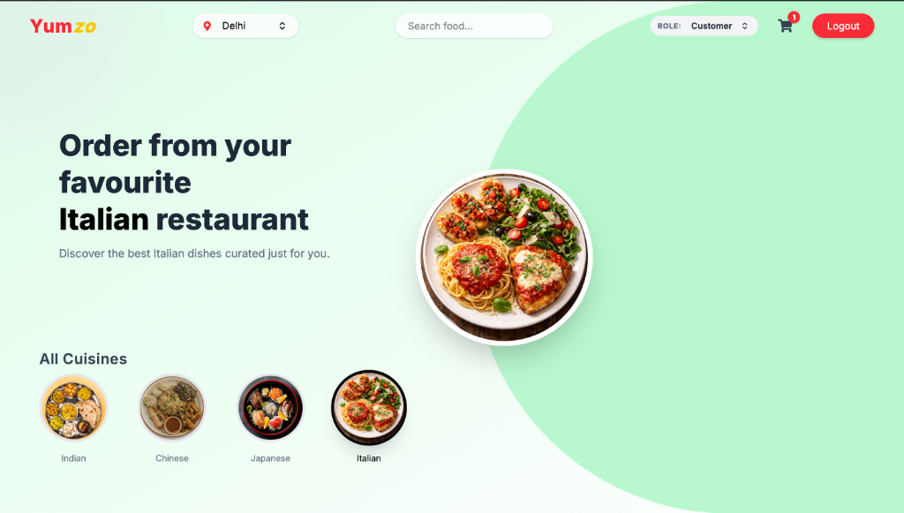
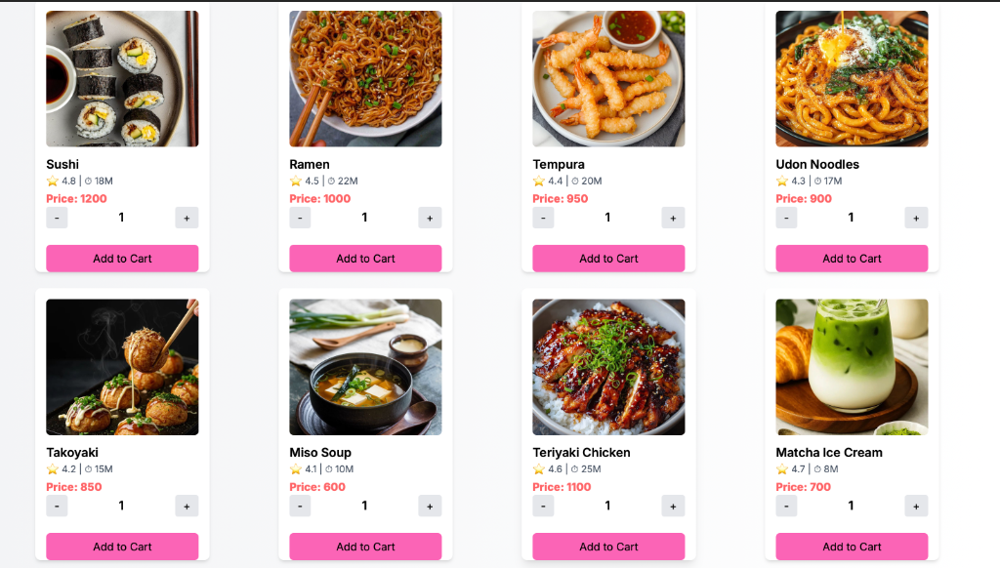

# 🍔 Yumzo - Unified Next.js Full-Stack Food Delivery Platform

Welcome to **Yumzo**, a modern, end-to-end food delivery application built to simulate platforms like UberEats or DoorDash. The project is completely unified into a single **Next.js** full-stack architecture featuring a responsive React frontend, integrated Next.js API route handlers, Socket.io for real-time synchronization, MongoDB with Mongoose for persistence, and Stripe for checkout payments.

---

## 📸 Project Screenshots

Here is a visual overview of the key views and dashboards implemented in Yumzo:

| 🏠 Landing Page | 🧑‍💻 Customer Home |
| :---: | :---: |
|  |  |

| 🍣 Interactive Menu | 🏪 Restaurant Kitchen Dashboard |
| :---: | :---: |
|  |  |

| 🚴 Delivery Driver Dashboard |
| :---: |
|  |

---

## 🛠️ Architecture

The repository is structured as a clean, unified Next.js project:

```text
Yumzo/
├── public/                     # Static media assets
│   ├── images/                 # All 40 curated cuisine & food images
│   ├── videos/                 # Hero background video (food.mp4)
│   └── screenshots/            # Showcase images
├── src/
│   ├── app/                    # Next.js App Router (Pages & API Route Handlers)
│   │   ├── page.jsx            # Video Hero Landing Page
│   │   ├── home/               # Customer Home (Browse by Cuisine & Search)
│   │   ├── login/              # Sign In page
│   │   ├── signup/             # Sign Up page
│   │   ├── account/            # Order history & reordering
│   │   ├── orders/[id]/        # Real-time Order Tracker with Socket.io
│   │   ├── order-success/[id]/ # Payment success confirmation
│   │   ├── order-cancelled/    # Payment cancelled screen
│   │   ├── dashboard/
│   │   │   ├── restaurant/     # Kanban-style kitchen dashboard
│   │   │   └── driver/         # Delivery driver dispatch & pickup queue
│   │   └── api/                # Unified Next.js backend API routes
│   │       ├── auth/           # Login, Register, Logout
│   │       ├── restaurants/    # Restaurants & menus
│   │       ├── orders/         # Orders & status management
│   │       ├── payments/       # Stripe checkout & webhooks
│   │       ├── dashboard/      # Restaurant kitchen orders
│   │       └── driver/         # Available pickups for drivers
│   ├── components/             # Reusable UI components (Navbar, Cart, Card, Tracker, etc.)
│   ├── data/                   # Menu and Restaurant datasets
│   ├── hooks/                  # Socket.io client hook (useSocket)
│   ├── lib/                    # MongoDB connection caching, Socket.io emitter, JWT, Auth helpers
│   ├── models/                 # Mongoose models (User, Restaurant, MenuItem, Order)
│   └── store/                  # Zustand state stores (useCartStore, useAuthStore)
├── server.js                   # Node server uniting Next.js with Socket.io on one port
├── seed.js                     # MongoDB seeding script
├── package.json                # Project dependencies & scripts
└── next.config.mjs             # Next.js configuration
```

---

## ⚡ Features

### 🧑‍💻 Customer Journey
- **Video Hero Landing Page**: Modern landing screen with smooth scroll animations.
- **Browse by Cuisine**: Filter menus dynamically (Indian, Chinese, Italian, Japanese).
- **Interactive Cart**: Slide-out cart displaying quantities, subtotal calculations, promo codes (`YUMZO10`), and item counts.
- **Stripe Checkout**: Integrated checkout for secure payment processing.

### 🏪 Restaurant Kitchen Dashboard
- **Kanban-Style Live tracking**: Column stages for **Accepted**, **Preparing**, and **Ready**.
- **Real-Time Synchronization**: Instantly broadcast status updates via Socket.io.

### 🚴 Delivery Driver App
- **Availability State**: Online/Offline active queue.
- **Available Pickups**: Live queue displaying orders marked as "Ready" from the kitchen.
- **Real-time status updates**: Drivers accept pickups and advance orders to "Out for Delivery" and "Delivered".

---

## 🚀 Getting Started

Follow these simple steps to run Yumzo locally in 1 unified command.

### Prerequisites
- Node.js (v18+)
- npm
- MongoDB instance (local server or Atlas connection string)

---

### Setup & Run

1. **Install Dependencies**:
   ```bash
   npm install
   ```

2. **Environment Variables**:
   Create a `.env` file in the root directory (a template `.env.example` is provided):
   ```env
   PORT=3000
   NODE_ENV=development
   MONGO_URI=mongodb://127.0.0.1:27017/yumzo
   JWT_SECRET=your_jwt_secret_key
   STRIPE_SECRET_KEY=your_stripe_secret_key
   STRIPE_WEBHOOK_SECRET=your_stripe_webhook_secret
   NEXT_PUBLIC_SOCKET_URL=http://localhost:3000
   ```

3. **Seed the Database** (Optional):
   Populate MongoDB with sample restaurants, menus, and a demo user:
   ```bash
   npm run seed
   ```

4. **Start the Development Server**:
   ```bash
   npm run dev
   ```
   Open [http://localhost:3000](http://localhost:3000) in your browser. Both Next.js and Socket.io run simultaneously on the same port!

---

## 🔄 Live Interactive Testing (Demo Guide)

To easily experience the full-stack flow, Yumzo includes a **Role Switcher** in the main navigation header:

1. **Customer**:
   - Browse the menu at `/home`, add items (e.g. Sushi, Ramen), and click **Checkout** in the Cart.
2. **Restaurant**:
   - Change your role to **Kitchen** in the dropdown or navigate to `/dashboard/restaurant`.
   - Your order will appear in the **Accepted** column. Click to advance it to **Preparing**, then **Ready**.
3. **Driver**:
   - Change your role to **Driver** or navigate to `/dashboard/driver`.
   - The order will appear under **Available Pickups**. Click to accept the pickup, then tap **Complete & Mark as Delivered**.
