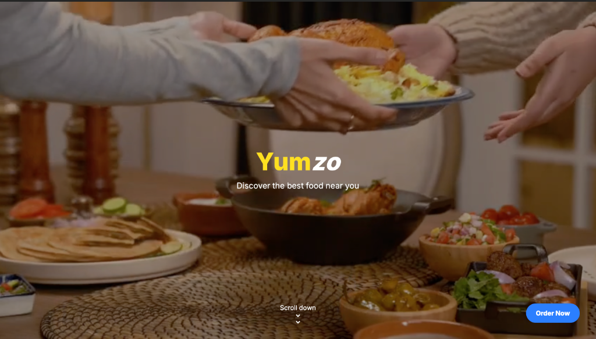
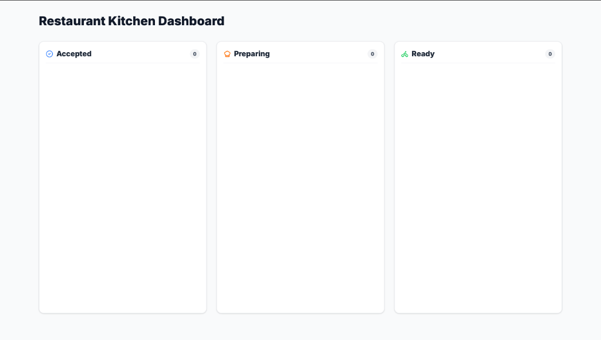
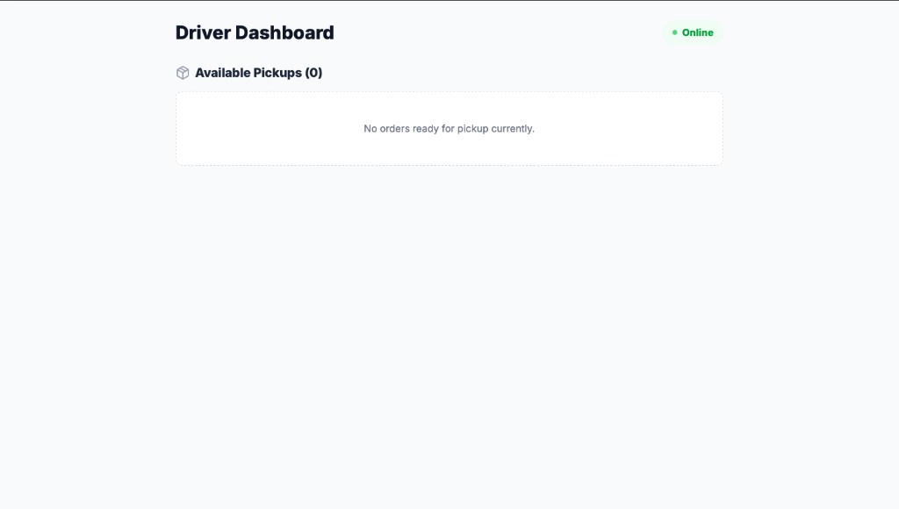

<div align="center">
  
  <h1>🍔 Yumzo - Frontend Application</h1>
  <p><b>Your favorite meals, delivered fast.</b></p>
  <p>The client side of the Yumzo food delivery platform, featuring a rich, responsive interface with role-based dashboards, a real-time order tracker, and integrated payment flows.</p>

  <p>
    <a href="#about-the-project">About The Project</a> •
    <a href="#screenshots">Screenshots</a> •
    <a href="#features">Features</a> •
    <a href="#tech-stack">Tech Stack</a> •
    <a href="#getting-started">Getting Started</a> •
    <a href="#architecture">Architecture</a>
  </p>
</div>

---

## 📖 About The Project

This is the frontend client for **Yumzo**, built with **React**, **Vite**, and **Tailwind CSS**. It communicates with a backend API using HTTP requests and WebSocket connections (Socket.io) to synchronize actions between the Customer, Restaurant Kitchen, and Delivery Driver in real time.

---

## 📸 Screenshots

Here is the app in action:

| 🏠 Landing Page | 🧑‍💻 Customer Home |
| :---: | :---: |
|  |  |

| 🍣 Interactive Menu | 🏪 Restaurant Dashboard |
| :---: | :---: |
|  |  |

| 🚴 Driver Dashboard |
| :---: |
|  |

---

## ✨ Features

### 🛒 Customer Experience
- **Immersive Discovery**: Interactive landing page with scroll animations and video background (`Landing` inside `App.jsx`).
- **Dynamic Cuisines**: Filter and browse dishes by category (Indian, Chinese, Italian, Japanese).
- **Zustand-powered Cart**: Add, remove, and adjust item quantities in a slide-over sidebar with automatic calculations.
- **Stripe Checkout Integration**: Seamlessly redirects to Stripe for dummy transactions.

### 🏪 Restaurant Kitchen Dashboard
- **Kanban Pipeline**: Track orders in Columns: **Accepted**, **Preparing**, and **Ready**.
- **State Progression**: Advance orders to the next stage in one click.

### 🚴 Delivery App
- **Driver Toggle**: Toggle Online/Offline state to receive delivery tasks.
- **Order Pickup Queue**: Automatically pulls in orders marked as "Ready" for pickup.

---

## 🛠️ Tech Stack

- **Framework**: [React 19](https://react.dev/) + [Vite](https://vitejs.dev/)
- **Styling**: [Tailwind CSS v4](https://tailwindcss.com/)
- **State Management**: [Zustand](https://github.com/pmndrs/zustand) (stores located under `src/store`)
- **Routing**: [React Router v7](https://reactrouter.com/)
- **Animations**: [Framer Motion](https://www.framer.com/motion/)
- **Icons**: [React Icons](https://react-icons.github.io/react-icons/)
- **Sockets**: [Socket.io Client](https://socket.io/docs/v4/client-api/)

---

## 🚀 Getting Started

### Prerequisites
- Node.js (v18+)
- npm
- The Backend server running at `http://localhost:5000` (see instructions in the root repository `README.md`).

### Installation & Run

1. Navigate to the `Yumzo` folder:
   ```bash
   cd Yumzo
   ```
2. Install frontend dependencies:
   ```bash
   npm install
   ```
3. Start the development server:
   ```bash
   npm run dev
   ```
4. Access the app at [http://localhost:5173](http://localhost:5173).

---

## 📂 Architecture

```text
Yumzo/
├── public/                 # Static assets (videos, category icons, favicons)
├── screenshots/            # Showcase images for the README
├── src/
│   ├── assets/             # Global CSS and local assets
│   ├── components/         # Reusable UI components
│   │   ├── Card.jsx        # Food item cards
│   │   ├── Cart.jsx        # Slide-out Cart component
│   │   ├── navbar.jsx      # Navigation bar with Role Switcher
│   │   └── searchbar.jsx   # Search input field
│   ├── data/               # Static fallback data
│   ├── hooks/              # Custom hooks (e.g. useSocket.js)
│   ├── pages/              # Main routing pages
│   │   ├── home.jsx        # Customer dashboard page
│   │   └── dashboards/     # Driver & Restaurant dashboards
│   ├── store/              # Zustand global state (Auth and Cart)
│   ├── App.jsx             # Route paths and layout definitions
│   └── main.jsx            # React root mount point
└── package.json            # Scripts & dependencies
```
